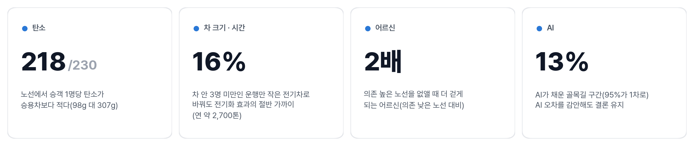
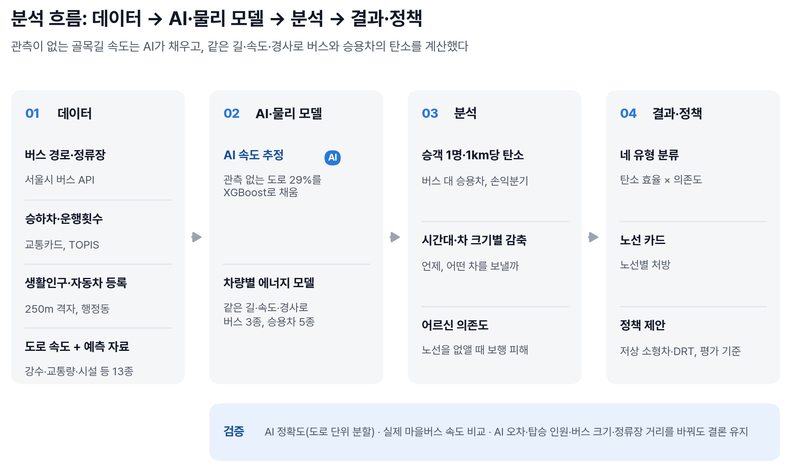
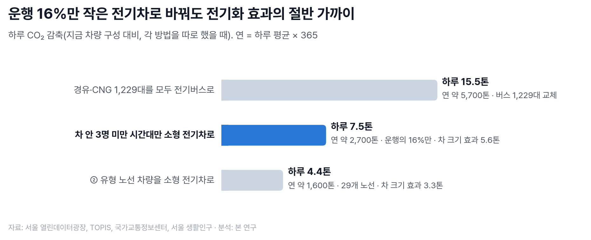
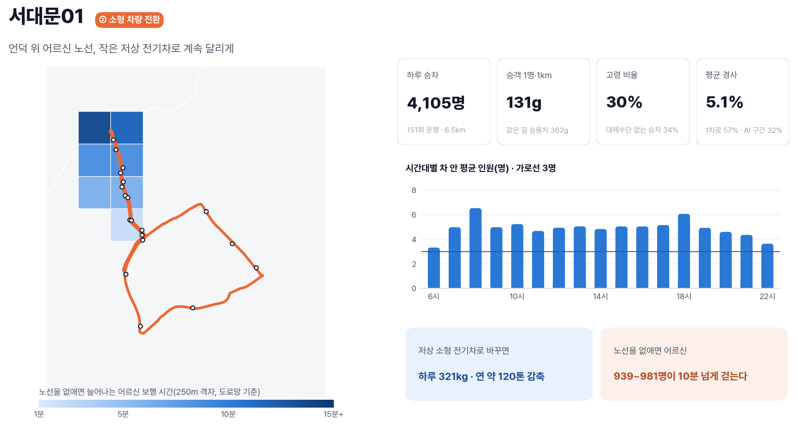

# 마을버스는 언제 친환경인가

**AI로 보완한 골목길 속도에 기반한 서울 마을버스 230개 노선의 탄소 효율과 고령자 이동권 분석**

한겨레 × 숲과나눔 「AI와 함께하는 교통문제 해결을 위한 데이터 분석 공모전」 출품작 · 팀 덜컹덜컹달려간다마을버스야(전예준, 김명관)

| 바로 보기 | 내용 |
| --- | --- |
| [분석 보고서](docs/report/maeul_bus_report.md) | 공모전 제출 보고서 본문과 그림 |
| [데이터 명세](data/README.md) | 공공데이터 23종의 선정 이유, 사용처, 전처리, 결합 구조 |
| [AI 속도 모델](docs/SPEED_MODEL.md) | 관측 공백 도로의 속도 추정: 데이터, 모델, 검증 |
| [마을버스 분석](docs/TRANSIT_MAEUL_BUS.md) | 분석 단계별 방법, 차량 에너지 모델, 결과, 한계 |
| [모델 개발 노트북](notebooks/README.md) | 속도 모델의 기준모형·변수·계층 비교 실험 기록 |
| [재현 방법](#10-재현-방법) | 설치와 실행 순서 |

## 목차

1. [개요](#1-개요)
2. [문제 제기](#2-문제-제기)
3. [연구 질문](#3-연구-질문)
4. [핵심 결과](#4-핵심-결과)
5. [분석 방법](#5-분석-방법)
6. [주요 결과](#6-주요-결과)
7. [정책 제안](#7-정책-제안)
8. [한계](#8-한계)
9. [저장소 구조](#9-저장소-구조)
10. [재현 방법](#10-재현-방법)
11. [AI 활용](#11-ai-활용)

## 1. 개요

서울 마을버스는 지하철과 일반버스가 닿지 않는 언덕·골목 주거지를 잇는 생활 교통이다. 그러나 재정 지표로 보면 상당수가 적자이고, 차량 1대 기준으로는 승용차보다 탄소를 더 배출한다. 본 연구는 공공데이터 23종(약 110GB)을 결합하여 마을버스 230개 노선의 **승객 1명당 탄소**를 같은 도로·속도·경사 조건의 승용차와 비교하고, 노선을 폐지할 때 **고령자가 잃는 접근성**을 정량화하였다. 속도 관측이 없는 골목길 구간은 XGBoost 기반 속도 모델로 보완하였다. 이를 통해 적자 노선을 '줄일 것인가, 지킬 것인가'의 양자택일 대신, 수요에 맞는 크기의 차량으로 '계속 운행하는' 선택지를 데이터로 검토한다.

## 2. 문제 제기

**생활 교통과 재정 압력의 충돌.** 서울 마을버스 247개 노선의 하루 승차는 약 93만 건이며, 마을버스 정류장의 18.7%는 지하철역 500m 밖이면서 200m 안에 일반버스 정류장이 없다. 반면 운행 1회 원가(약 2.9만 원)와 승차당 실수입(600~1,200원)으로 근사하면 230개 노선 중 74~177개가 운행비를 충당하지 못한다. 운송수입만으로 노선을 평가하면 대체 수단이 없는 지역의 노선이 감편·폐지 대상이 될 수 있다.

**'버스는 친환경'이라는 전제의 조건.** 차량 1대가 1km를 갈 때 마을버스는 승용차보다 CO₂를 더 배출한다(서울 현재 차량 구성 기준 506g 대 369g). 버스의 탄소 이점은 여러 승객이 배출을 나누어 질 때만 성립하므로, 승객이 적은 노선과 시간대에서는 줄어들거나 사라질 수 있다.

**골목길의 관측 공백.** 노선별 탄소를 계산하려면 노선이 지나는 모든 도로의 시간대별 속도가 필요하다. 그러나 서울 도로 링크의 29%는 속도 관측이 없고, 그 공백은 마을버스가 다니는 1차로 골목에 집중되어 있다.

## 3. 연구 질문

1. 마을버스는 승객 1명 기준으로 승용차보다 탄소를 적게 배출하는가?
2. 추가 감축에는 연료 전환, 차량 규모, 운행 시간대 중 무엇이 효과적인가?
3. 고령자의 이동권을 유지하면서 이를 달성할 수 있는가?

## 4. 핵심 결과



| 연구 질문 | 결과 |
| --- | --- |
| ① 승객 1명 기준 탄소 | **조건부 친환경.** 승객·km당 CO₂는 마을버스 98g, 승용차 307g(노선 중앙값)으로 230개 노선 중 218개(94.8%)에서 버스가 적었다. 손익분기 재차인원은 1.66명, 실제 중앙값은 5.38명이다. 다만 저녁 20~22시에는 운행의 26.3%가 재차인원 3명 미만이었다. |
| ② 효과적인 감축 수단 | **연료보다 크기와 시간.** 재차인원 3명 미만 시간대(전체 운행의 15.9%)만 소형 전기차로 전환해도 하루 7.53톤이 감축되어, 경유·CNG 1,229대 전면 전기화 효과(15.54톤)의 48.5%에 이른다. |
| ③ 고령자 이동권 | **줄이지 말고 작게.** 고령자 의존도가 높은 노선은 적자 비율이 높지만, 폐지 시 접근시간이 늘어나는 고령 생활인구가 의존도가 낮은 노선의 약 2배(1,372~1,684명 대 641~749명, 노선 중앙값)이다. |
| AI 속도 보완 | 관측이 없는 마을버스 구간(노선 길이의 13%, 그중 95%가 1차로 골목)을 XGBoost로 추정하였다(R² 0.72, MAE 4.6km/h). 추정 속도를 ±5km/h 바꾸어도 버스 우위 노선 217개, 유형 유지 노선 208개로 결론이 유지되었다. |

## 5. 분석 방법



### 5.1 데이터

7개 기관·9개 플랫폼의 공공데이터 23종을 네 묶음으로 결합하였다. 데이터별 선정 이유와 사용처는 [데이터 명세](data/README.md)에 있다.

| 묶음 | 데이터 | 역할 |
| --- | --- | --- |
| 도로 속도 추정 | 표준노드링크, 5분 통행속도, DEM, 레이더 강수, 도로 시설·사고다발지역, 교통량·View-T, 생활인구 | AI 속도 모델의 학습 목표와 설명 변수 |
| 수송·운행 | 노선별 정류소, 실제 경로(API), 정류장별 승하차, 운행횟수, 노선유형별 버스 속도 | 노선 맵매칭, 재차인원, 외부 속도 점검 |
| 고령자·대체수단 | 생활인구(250m 격자·행정동), 지하철 역사 | 고령자 의존도, 노선 제거 시 접근성 |
| 차량 구성 | 연료별 자동차 등록(자치구·행정동), 마을버스 연료 현황 | 버스·승용차 배출 가중, 동네별 승용차 보유 |

### 5.2 AI 기반 미관측 도로 속도 추정

관측 이력이 있는 도로는 동일 시간대 이력 평균(A), 관측은 없으나 이웃 도로가 관측되는 도로는 이웃속도를 포함한 XGBoost(B), 이웃 관측도 없는 도로는 이를 제외한 XGBoost(C)로 속도를 추정하였다. 13개 원자료를 결합한 61개 변수를 쓰고, 학습에 쓰지 않은 도로로 평가하는 도로 단위 GroupKFold로 검증하였다.


| 계층 | 검증 방식 | R² | MAE |
| --- | --- | ---: | ---: |
| A 관측 이력 | 시간 순서 분할 | 0.92 | 2.3km/h |
| B 이웃속도 포함 XGBoost | 도로 단위 3-fold GroupKFold(이웃 조회표도 fold별 재구성) | 0.72 | 4.6km/h |
| C 이웃속도 제외 XGBoost | 〃 | 0.31 | 5.7km/h |

단순 기준모형(제한속도 회귀 R² 0.17, 도로등급 평균 0.27)은 더 관대한 무작위 분할에서도 이에 미치지 못했다. SHAP 기준 최대 기여 변수는 이웃 도로 속도(35.6%)였다. 상세는 [AI 속도 모델](docs/SPEED_MODEL.md)에 있다.

### 5.3 동일 조건 탄소 비교

버스와 승용차를 같은 노선, 같은 평일 시간대별 속도, 같은 진행 방향 경사에서 비교하였다. 전기차는 VT-CPEM, 내연기관 승용차는 VT-CPFM 계열, 하이브리드는 Ahn & Rakha(2019) 모형으로 계산하고 공인 연비·전비로 보정하였으며, 경유·CNG 버스는 서울 실측 비율로 환산하였다. 차종별 배출은 서울의 실제 연료 구성으로 가중평균하였다.

- 재차인원 L = 하루 승객·km ÷ 하루 차량·km(정류장 순서대로 '승차 − 하차'를 누적하고, 실제 운행횟수로 차량·km 산정)
- 버스 승객·km당 배출 = b ÷ L, 승용차 승객·km당 배출 = c ÷ o(o = 1.2명)
- 탄소 손익분기 재차인원 L* = b × o ÷ c

### 5.4 고령자 의존도와 노선 제거의 접근성 손실

고령 비율, 고령 인구, 대체수단 없는 승차 비중의 백분위 순위를 평균하여 의존도 점수를 만들고, 의존도와 승객·km당 배출을 각각 노선 중앙값으로 나누어 네 유형으로 분류하였다. 군집분석(K-평균, 가우시안 혼합, HDBSCAN)은 분리도가 낮아 채택하지 않았다. 접근성 손실은 노선을 하나씩 제거한 뒤, Tobler 보행속도에 고령자 계수 0.75와 진행 방향 경사를 반영한 다중 출발 Dijkstra로 250m 격자별 접근시간을 다시 계산하여 구하였다.

### 5.5 검증과 강건성

| 점검 | 조건 | 결과(230개 노선 기준) |
| --- | --- | --- |
| AI 추정 속도 | 미관측 구간 ±5km/h | 버스 우위 217개, 유형 유지 208개 |
| 외부 속도 점검 | TOPIS 마을버스 실측(2026.10) | 주간 차이 약 1km/h, 20~22시 약 2.5km/h |
| 승용차 탑승인원 | 1.2 → 1.35 → 1.82명 | 버스 우위 218 → 215 → 206개 |
| 버스·승용차 배출 | 버스 1.28·1.5배, 승용차 0.8배, 최악 조합 | 버스 우위 212·206개, 212개, 192개 |
| 대체수단 기준 | 일반버스 150·300m, 도로망 거리 | 유형 유지 212·208개, 201개 |

모든 수치는 `src/transit/checks/`의 스크립트로 재현된다.

## 6. 주요 결과

**마을버스는 조건부 친환경이다.** 대부분의 노선이 손익분기(1.66명)를 크게 웃돌지만, 승용차보다 배출이 많은 12개 노선은 모두 재차인원 2명 미만이었다. 저녁 시간대의 재차인원 저하는 수요 부족이 아니라 짧은 승차로 동시 탑승이 적은 데서 비롯되며(해당 운행 1회 누적 승차 중앙값 13.8명), 문제는 수요에 비해 큰 차량이다.


**연료보다 차량 규모와 운행 시간대가 중요하다.** 15인승급 소형 전기차의 배출(1km당 242g)은 전기 마을버스(437g)보다 약 45% 낮아, 한산한 시간대의 차량 규모 조정이 전면 전기화의 절반에 가까운 감축을 낸다.



**고령자 의존 노선은 감축이 아닌 전환의 대상이다.** '소형 차량 전환' 유형(55개)은 고령 비율이 가장 높고 승용차 보유가 가장 낮으며, 73%가 운행비를 충당하지 못한다. 그러나 이 유형을 제거할 때의 접근성 손실은 '증편·지원 우선' 유형에 가깝다.


**노선 단위 처방.** 서대문01은 구간 최대 재차인원 7.7명으로 저상 소형 전기차 전환 시 서비스를 유지하며 하루 321kg을 줄일 수 있는 반면, 같은 유형의 관악04는 16.9명으로 소형차 용량을 넘어 차량 규모 유지와 전기화가 적합하다.



## 7. 정책 제안

| 정책 | 대상 | 실행 방안 | 기대효과 |
| --- | --- | --- | --- |
| 노선 평가 기준 보완 | 마을버스 재정지원·노선 조정 심사 | 운송수입에 탄소 효율과 노선 제거 시 접근성 손실을 함께 반영 | 고령자 의존 노선의 유지 근거 확보 |
| 저상 소형 전기차 전환 | 소형 차량 전환 유형 중 구간 최대 재차 8명 이하 29개 노선 | 피크 탑승·휠체어 접근·충전 여건 확인 후 경로·배차 유지 | 하루 약 4.43톤 잠재 감축 |
| 시간대별 차량 규모 조정 | 재차인원 3명 미만 시간대(운행의 15.9%) | 소형차 시범, 권역 단위 차량 공유, DRT 연계 | 하루 약 7.53톤, 전면 전기화 효과의 48.5% |
| 승용차 전환을 확인한 증편 | 승용차 보유가 많고 증편 손익분기가 낮은 30개 노선 | 시범 증편 후 신규 이용자의 기존 수단 조사 | 실제 전환에 근거한 순 탄소 효과 확인 |

감축량은 각 시나리오를 독립적으로 적용한 잠재치이며 서로 합산할 수 없다.

## 8. 한계

- 노선별 차량 정보가 없어 서울 전체 연료 구성과 중형 차량을 공통 적용하였다(대형 비중은 배출 배율 민감도로 검토).
- 에너지 모형은 공인값으로 보정한 정속 근사이며 실차 충전·연료 기록으로 검증하지 않았다.
- AI 속도 검증은 관측 도로를 가려서 수행한 대리 평가로, 실제 미관측 골목의 분포와 다를 수 있다.
- 소형차 용량 판단은 평균 재차인원 기반이므로 현장의 피크 탑승 확인이 필요하다.
- 접근성 손실은 가장 가까운 정류장까지의 보행만 반영하여 목적지 차이에 따른 불편은 과소추정된다.

## 9. 저장소 구조

```text
seoul-maeul-bus-carbon/
├── src/
│   ├── pipeline/      01~05 도로 속도 데이터 구축(서울 링크, 5분 속도 집계, 레이더 강수, 링크 차원 표, 관측속도 팩트)
│   ├── models/        01~04 AI 속도 모델(A 조회표, B·C XGBoost 학습·검증·예측), weather_snapshot, artifacts/
│   ├── energy/        차량별 에너지·배출 모델(VT-CPEM, VT-CPFM 계열, HEV, 경유·CNG 버스 환산)
│   └── transit/       00~10 마을버스 분석, checks/ 수치 재현·강건성 검증, report_figures 보고서 그림
├── notebooks/         속도 모델 개발 실험 기록(README.md에 노트북별 요약)
├── tests/             에너지 모델 단위 테스트
├── docs/              SPEED_MODEL.md, TRANSIT_MAEUL_BUS.md, report/(보고서와 그림)
├── data/              README.md(데이터 명세), raw·interim·processed 폴더 구조
└── requirements.txt
```

## 10. 재현 방법

Python 3.13에서 검증하였다. 원자료는 저장소에 포함하지 않으므로 [데이터 명세](data/README.md)의 출처에서 내려받아 같은 경로에 둔다.

```powershell
pip install -r requirements.txt
python -m unittest tests.test_link_energy        # 에너지 모델 테스트(10개)
```

**마을버스 분석(보고서 결과 재현).** 전 링크 속도 예측 결과와 마을버스 원자료가 있으면 번호 순서대로 실행한다(캐시가 없을 때 약 3.5분).

```powershell
python src/transit/01_build_bus_route_links.py
python src/transit/02_build_route_demand.py
python src/transit/03_build_route_feasibility.py
python src/transit/04_build_route_energy.py
python src/transit/05_build_route_carbon_breakeven.py
python src/transit/06_classify_route_priority.py
python src/transit/07_build_route_operations.py
python src/transit/08_access_gap.py
python src/transit/09_validate_ai_speed.py
python src/transit/10_route_removal_access.py

python src/transit/checks/report_numbers.py          # 보고서 수치 재현
python src/transit/checks/assumption_sensitivity.py  # 가정 민감도
python src/transit/checks/ai_speed_stress.py         # AI 속도 ±5km/h
python src/transit/checks/cluster_check.py           # 군집분석 점검
```

**AI 속도 예측(학습된 모델 사용).** 학습된 모델과 조회표가 저장소에 있어 재학습 없이 예측할 수 있다.

```powershell
python src/models/weather_snapshot.py --tm 202607160800                                # 한 시점: 링크별 레이더 강수
python src/models/03_predict_all_link_speed.py --tm 202607160800                       # 한 시점: 전 링크 속도
python src/models/04_batch_predict_all_link_speed.py --start-date 20260707 --end-date 20260720   # 기간 전체
```

**원자료부터 전체 재구축.**

```powershell
python src/pipeline/01_extract_seoul_links.py
python src/pipeline/02_aggregate_5min_speed.py
python src/pipeline/03_fetch_kma_radar.py --from-5min-times     # 환경변수 KMA_API_KEY 필요
python src/pipeline/04_build_link_dimension.py
python src/pipeline/05_build_speed_fact.py

python src/models/01_build_model_a.py
python src/models/02_build_model_bc.py --mode validate          # 도로 단위 GroupKFold 검증
python src/models/02_build_model_bc.py --mode final             # 최종 학습
python src/models/04_batch_predict_all_link_speed.py --start-date 20260707 --end-date 20260720
python src/transit/checks/validate_bc_tiers.py                  # B·C 계층별 성능(약 1시간)
```

노선 실제 경로를 다시 받으려면 `src/transit/00_fetch_bus_route_paths.py`를 실행한다. API 인증키는 코드와 저장소에 넣지 않고 환경변수로만 읽는다.

```powershell
$env:SEOUL_BUS_API_KEY = "<서울시 버스운행정보 API 키>"
$env:KMA_API_KEY = "<기상청 API허브 키>"
```

**검증 기록.** 새로 복제한 저장소에서 위 순서를 실행한 결과, 마을버스 분석 산출물 23종과 보고서 수치, 저장된 모델의 전 링크 예측(2026.7.16 08시, 63,548개 링크), 데이터 파이프라인 01·04의 산출물이 기존 결과와 일치함을 확인하였다.

## 11. AI 활용

- **분석 방법으로서의 AI**: XGBoost로 관측이 없는 도로의 시간대별 속도를 추정하고(5.2), SHAP으로 변수 기여를 해석하였다. AI 추정의 오차가 결론에 미치는 영향은 ±5km/h 강건성 시험으로 확인하였다(5.5).
- **분석 수행 도구로서의 생성형 AI**: Claude Code와 OpenAI Codex를 코드 작성, 결과 재검증, 보고서 표현 점검에 활용하였다. 작업은 '연구자의 질문 설정 → AI의 코드 작성·실행 → 다른 AI 서비스의 교차 검토 → 연구자의 채택 판단' 순서로 진행하였고, 활용 내용과 주요 프롬프트는 [보고서 5.2절](docs/report/maeul_bus_report.md#52-생성형-ai를-활용한-분석-수행과-교차-검증)에 있다.
