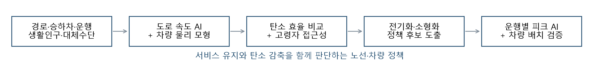

# AI 기반 수요 예측과 차량 배치 최적화를 통한 마을버스 탄소 감축 및 교통약자 이동권 보장 방안

한겨레 × 숲과나눔 「AI와 함께하는 교통문제 해결을 위한 데이터 분석 공모전」 분석보고서 · 전예준, 김명관 / 작다고 간편하지 마라

제출본(PDF): [작다고간편하지마라_분석보고서.pdf](작다고간편하지마라_분석보고서.pdf). 이 문서는 제출본의 본문을 그대로 옮기고 그림을 원본 해상도로 연결한 것이다.

## 분석 배경 및 목적

### 1). 마을버스의 이동권 가치와 탄소 효율의 동시 평가 필요성

마을버스는 언덕·골목의 주거지를 지하철·일반버스·생활시설에 연결한다. 본 분석 대상 230개 노선의 하루 승차는 약 90만 건이며, 이는 서로 다른 이용자 수가 아닌 승차 건수이다. 보행이 어렵거나 대체수단이 부족한 주민에게는 짧은 버스 구간이 전체 이동의 가능성을 결정하므로, 이동거리와 이용량만으로 사회적 가치를 판단하기 어렵다. 반면 적은 승객을 위해 큰 차량을 반복 운행하면 탄소 효율이 낮아질 수 있다. **필요한 서비스를 유지하면서 친환경 전환을 어떻게 설계할 것인가**가 본 분석의 출발점이다.

### 2). 서비스 확충 정책에 필요한 노선별 판단 근거

서울시는 2025년 12월 서비스 개선 합의에서 2026년 마을버스 재정지원 확대(412억→500억 원)와 전체 운행 약 5% 확대를 발표했다[1]. 이는 추진 계획으로, 본 분석이 실제 달성률을 검증한 것은 아니다. 서비스 확충을 탄소중립과 연결하려면 연료 전환뿐 아니라 **어느 노선의 서비스를 유지·확대하고, 어디에서 차량 규모를 조정할지 판단할 근거가 필요**하다. 고령자 교통카드 이용 및 저상버스 배치 연구[2,3]에서 다룬 이용 특성과 접근 조건을 탄소 효율·차량 용량과 함께 평가할 필요가 있다.

### 3). 참여 목적과 분석 질문

참여 목적은 탄소중립과 이동의 형평성을 같은 판단 체계에 연결하는 것이다. 필요한 노선을 유지하면서 배출을 줄이려면, 서비스의 사회적 필요성과 차량 전환의 적합성을 함께 확인해야 한다. 이를 위해 다음 다섯 질문을 설정하고, 분석 내용 및 결과에서 같은 순서로 답한다.

1. **탄소 효율:** 동일 운행 조건에서 마을버스는 승용차보다 탄소 효율이 높은가? 전기화와 저재차 시간대 소형화에는 어느 정도의 감축 여지가 있는가?
2. **정책 유형:** 탄소 효율과 고령자 의존도를 함께 보면, 어떤 노선에서 지원·서비스 유지·차량 규모 조정을 우선 검토해야 하는가?
3. **접근성 손실:** 고령자 의존도가 높은 노선을 제거하면 정류장 접근성이 얼마나 악화되는가?
4. **수송 용량:** 평균 수요가 낮다는 이유만으로 소형화해도 되는가? AI 피크 예측은 전환 후보의 정원 초과 위험을 줄이는가?
5. **운영 조건:** 용량·배터리·차량 수·자료 일관성 조건을 적용하면 어느 노선의 운행을 전환 후보로 선정할 수 있으며, 차량 확보 규모에 따라 감축 효과는 어떻게 달라지는가?

이 질문에 대한 답을 바탕으로 서비스 유지·지원의 근거와 차량 전환의 검토 우선순위를 제시하고, 증편은 별도로 실제 승용차 전환 가능성을 확인하도록 제안한다.

## 활용 데이터

| 활용 데이터·선정 이유 | 제공기관(명) | 플랫폼(명) | URL |
| --- | --- | --- | --- |
| 표준노드링크·5분 속도: 방향성 도로망과 속도 관측 | 국토교통부 | ITS | [its.go.kr](https://www.its.go.kr/nodelink/nodelinkStatus?service=inquiryNodelink) |
| HSR 강수·DEM: 속도 환경과 방향성 경사 | 기상청·국토지리정보원 | API허브·국토정보 | [apihub.kma.go.kr](https://apihub.kma.go.kr/apiList.do?seqApi=5), [map.ngii.go.kr](https://map.ngii.go.kr/) |
| AADT·혼잡, 전용차로·보호구역·험프·사고: 속도 변수 | 교통연구원·서울시·도로교통공단 | View-T·열린데이터·TAAS | [View-T](https://viewt.ktdb.go.kr/cong/map/page.do), [OA-22396](https://data.seoul.go.kr/dataList/OA-22396/F/1/datasetView.do), [OA-2799](https://data.seoul.go.kr/dataList/OA-2799/F/1/datasetView.do), [OA-15541](http://data.seoul.go.kr/dataList/OA-15541/A/1/datasetView.do), [TAAS](https://opendata.koroad.or.kr/api/selectPedstriansDataSet.do) |
| 노선 경로·정류소: 실제 거리·순서·도로 매칭 | 서울시 | 버스 API·열린데이터광장 | [OA-15264](https://data.seoul.go.kr/dataList/OA-15264/L/1/datasetView.do), [OA-1095](https://data.seoul.go.kr/dataList/OA-1095/L/1/datasetView.do) |
| 시간대 승하차·정류장 운행횟수: 승객·km·평균 재차 | 서울시·TOPIS | 열린데이터광장 | [OA-12913](https://data.seoul.go.kr/dataList/OA-12913/F/1/datasetView.do), [OA-21220](https://data.seoul.go.kr/dataList/OA-21220/S/1/datasetView.do) |
| 교통카드 이용·노선·정류장: 개별 운행 피크 검증 | 서울시 | T-DATA | [t-data.seoul.go.kr](https://t-data.seoul.go.kr/dataprovide/trafficdataviewfile.do?data_id=20006) |
| 생활인구·역사마스터·차량 등록: 의존도·대체수단·연료 구성 | 서울시·KT | 열린데이터 | [생활인구](https://data.seoul.go.kr/dataVisual/seoul/seoulLivingPopulation.do), [OA-21232](https://data.seoul.go.kr/dataList/OA-21232/S/1/datasetView.do), [OA-15640](https://data.seoul.go.kr/dataList/OA-15640/F/1/datasetView.do), [OA-21236](https://data.seoul.go.kr/dataList/OA-21236/F/1/datasetView.do) |
| 차량 제원·버스 현황·전력계수: 정원·배터리·배출 환산 | 제조사·서울시·기후부 | 공식 홈페이지 | [카운티 일렉트릭](https://www.hyundai.com/kr/ko/c/products/bus/county-electric), [e-JEST](https://www.karsan.com/en/electric-bus/e-jest/e-jest-specs), [서울시 교통](https://news.seoul.go.kr/traffic/archives/300), 전력계수[10] |

탄소·접근성 분석은 7월 집계자료 기반 247개 경로 중 수요 QA 17개를 제외한 230개 노선이다. 운행별 피크 검증은 7/6~8/9의 35일·247개 노선·846,653개 운행 키를 별도 사용한다. 도로 속도 7/7~7/20, 승하차·생활인구·차량 등록 7월, 집계 운행 7/6~7/31, 경로·정류소 일부 9월의 시점 차이를 관리한다.

## 분석과정 및 방법

본 분석은 수요가 적은 마을버스의 서비스 필요성과 수요에 적합한 차량 규모를 함께 평가한다. **고령자 의존도와 노선 제거 시 접근성 손실을 분석하여 유지·지원의 필요성을 검토하고, 운행별 피크 수요 예측과 차량 배치 최적화로 소형차 전환의 적합성을 평가한다(그림 1).** 노선과 배차를 유지하더라도 차량 용량이 부족해 승객을 수송하지 못하면 이동권이 저해될 수 있기 때문이다. 두 분석은 각각 '어떤 서비스를 지켜야 하는가'와 '어떤 운행의 차량을 바꿀 수 있는가'에 답하며, 반드시 같은 노선을 선정하는 것은 아니다.

*그림 1. 데이터 결합에서 탄소·이동권 평가, 정책 후보와 운행별 실행 검증까지의 전체 분석 흐름.*

### 1). 경로·속도·수요 결합과 동일 조건의 탄소 비교

**자료 결합과 전처리**

- (a) 실제 노선 경로를 방향성 도로망에 매칭하고, 정류장 구간 길이는 실제 경로선에서 측정하였다. 5분 단위 관측속도는 시간별로 집계하여 강수·시설·교통량·생활인구·도로망 구조와 결합하였다.
- (b) 미조사 결측은 유지하고 시설이 없는 경우만 0으로 처리하였다. DEM 기반 방향성 경사는 에너지·보행 계산에서 ±12%로 제한하였다.
- (c) 정류장별 '승차 − 하차'를 누적하고 하차 합계를 승차 합계에 맞춰 보정하여 승객·km를 계산하였다. 분기 노선은 정류장별 운행횟수 비율로 나누었다.
- (d) 평균 재차인원 L은 하루 승객·km ÷ 하루 차량·km로, 차 안에 동시에 탄 평균 인원이다.

**동일 조건의 탄소 비교**

- (a) 버스와 승용차를 같은 노선·속도·방향성 경사에서 비교하여, 차이가 차량과 탑승 인원에서만 나오도록 하였다.
- (b) 전기차는 VT-CPEM 계열 주행 저항[4]에 정지·출발·체류·보조전력·충전손실을 더해 계산하였다. 경유·CNG 버스는 서울 연구의 전기차 대비 배출 비율[5]로, 승용차는 연료별·하이브리드 모형과 공개 연비·전비[6]로 계산하였다.
- (c) 노선별 실차 정보가 없어 공통 차량 조건을 적용하고, 서울의 연료별 차량 구성으로 배출 원단위를 가중평균하였다.
- (d) 버스·승용차의 차량·km당 배출을 b, c, 승용차 평균 탑승인원을 o(1.2명)라 하면 버스 승객·km당 배출은 b/L, 승용차는 c/o, 탄소 손익분기 재차인원은 b×o/c이다.
- (e) 기준 전기버스는 7t·보조전력 5kW, 소형차는 휠체어 배치 시 승객 16명·105kWh 제원을 참조하여 5t·3kW로 가정하였다[9]. 주행 저항은 카운티 일렉트릭의 정속 주행거리로 보정하고 정지·출발·체류 에너지는 별도로 반영하였다. 운행 단계 배출만 다루며 차량 제조는 제외하였다.

### 2). 의존도·노선 제거 접근성과 정책 시나리오

**교통약자 의존도와 정책 유형**

- (a) 정류장 300m 안의 생활인구를 노선별로 중복 없이 집계하고 행정동 고령 비율을 적용해 고령 생활인구를 추정하였다. 지하철역 500m 밖이면서 일반버스 정류장이 200m 안에 없으면 대체수단 부족으로 보았다.
- (b) 고령 비율·고령 생활인구·대체수단 없는 승차 비중의 백분위 순위를 같은 가중치로 평균해 의존도 점수를 만들고, 의존도와 승객·km당 탄소를 각각 중앙값으로 나누어 네 정책 유형을 구성하였다.

**노선 제거 시 접근성 손실**

- (a) 노선을 하나씩 제거하고 그 노선만 정차하는 정류장을 뺀 뒤 최소 정류장 접근시간을 다시 계산하였다. 보행속도는 Tobler 함수에 고령자 계수 0.75와 방향성 경사를 반영하고[7], Dijkstra 알고리즘으로 도로망 최단시간을 구하였다. 직선거리×1.3 방식도 함께 계산하였다.
- (b) 지표는 접근시간이 1분 이상 늘어난 고령 생활인구, 새로 접근시간이 10분을 넘는 인구, 정류장까지 도로망 연결을 잃은 인구이다. 이는 실제 고령 승객 수가 아닌 주변 고령 생활인구이며, 대체 노선의 목적지·배차 부담은 포함하지 않았다.

**감축 시나리오와 다음 단계**

- (a) 전기화와 저재차 시간대 소형화의 잠재 감축량은 독립 시나리오로 산출하고 합산하지 않았다.
- (b) 평균 재차인원만으로는 특정 운행의 승객 집중과 차량 운용 조건을 판단할 수 없으므로, 다음 단계에서 운행별 수요 예측과 차량 배치 최적화로 전환 가능성을 검증하였다.

### 3). AI 예측과 차량 배치 최적화

도로 속도 추정으로 차량별 에너지를, 운행별 최대 재차인원 예측으로 소형차의 수송 용량을 평가한 뒤, 두 결과를 차량 배치 최적화에 결합하여 수요와 운영 제약을 만족하는 범위에서 탄소 감축량을 최대화하였다.

**관측이 없는 도로의 속도 추정(XGBoost)**

- (a) 골목길까지 분석하려면 관측 자료가 있는 큰 도로만으로는 부족하다. 관측 이력이 있는 도로는 해당 값을 조회하고, 없는 도로는 도로 특성과 이웃 도로의 속도 이력으로 추정하였다.
- (b) 추정 속도는 노선 경사와 함께 에너지 모형에 입력하여 같은 주행 조건에서 차량별 탄소 배출을 비교하였다.

**운행별 최대 재차인원 예측(XGBoost 분위수 회귀)**

- (a) 평균 이용량이 적어도 특정 운행에는 승객이 몰릴 수 있어, 교통카드 기록으로 각 운행의 최대 동시 탑승인원을 추정하였다.
- (b) 노선·시간·요일과 이전 7일 수요를 입력으로 분위수 모형을 학습하였다. Q50은 전형적인 수요를, Q95·Q99는 수요가 높아지는 상황을 판단하는 데 썼다.
- (c) 차량 전환에는 보정한 Q99 예측 상한을 사용하고, 이 상한이 정원 준수를 보장하지는 않으므로 학습에 쓰지 않은 검증 주간의 실제 탑승 기록과 대조하였다.

**차량 배치 최적화(MILP)**

- (a) 가정한 소형차 확보 대수와 배터리 용량 안에서 어느 노선의 운행을 교체할지 MILP로 결정하였다. 교체 단위는 차량별 하루 운행 묶음이다.
- (b) 예측 상한이 정원 이하이고 하루 에너지 사용량·투입 차량 수·자료 일관성 조건을 만족하는 묶음 중 감축량이 최대인 조합을 선택하였다.
- (c) 보정 기간에 노선별 차량 수를 정하고, 최종 검증 주간에는 배분을 고정해 날짜별 운행 선택과 성과를 평가하였다. 이로써 단순 소형화 잠재량과 운영 제약을 적용한 감축량을 구분하였다.

## AI 기술 활용

### 1). AI 예측 및 수리 최적화

| 기술 | 적용 범위·검증 방식 |
| --- | --- |
| 도로 속도 XGBoost | A: 관측 이력 조회, B: 이웃 이력 포함, C: 이웃 이력 제외. 매칭 노선 길이 13.2%를 AI로 보완. 도로 속도 모형의 기존 검증 결과는 B R²≈0.72·MAE 4.6km/h, C R²≈0.31·MAE 5.7km/h. |
| 운행 피크 XGBoost | Q50·Q95·Q99 회귀. 노선·시간·요일·이전 7일 수요를 입력하고 과거 수요 규모로 정규화. 잔차 상위 순서통계량으로 Q99를 보정[8]. 7/6~19 학습, 7/20~26 보정, 7/27~8/2 개발, 8/3~9 최종 검증. TreeSHAP은 예측 기여 설명에 사용. |
| MILP 차량 배치 | 보정 기간에 노선별 차량 수를 정하고, 최종 검증 주간에는 배분을 고정한 채 날짜별 운행 선택과 성과를 평가. 예측 상한·배터리·차량 수·자료 일관성을 제약으로 사용. 현재 특수 구조에서는 한계편익 탐욕법도 같은 최적값을 얻음. |

### 2). 생성형 AI 활용

Claude Code(Anthropic)와 OpenAI Codex를 수집·코드·단위·누수·정책 해석 검토에 활용했다. 재현 프롬프트 예: ① "도로·날짜 분할과 이웃·과거 수요 피처의 평가자료 유입을 점검하라." ② "승객·km·피크·감축 기준선·접근성 인구를 구분하고 차량 정원·배터리 제약을 검증하라."

## 분석 내용 및 결과

분석에서 도출한 핵심은 **대부분 노선의 탄소 이점과 고령자 접근성 유지 필요성을 확인했지만, 평균 수요가 적다는 사실만으로 소형차 전환을 결정할 수는 없다는 것**이다. 배경에서 제시한 다섯 분석 질문에 따라 탄소 감축 잠재량, 정책 유형, 접근성 손실, 운행 피크 위험, 운영 제약을 적용한 전환 후보를 순서대로 제시한다.

### 1). 마을버스는 승용차보다 탄소 효율이 높은가? 친환경 전환의 감축 여지는 얼마나 되는가?

**분석 결과: 대부분 노선은 승용차보다 탄소 효율이 높으며, 전기화와 저재차 시간대 차량 규모 조정에 개선 여지가 있다.**

분석 230개 노선 중 223개(97.0%)에서 현재 차량 구성 시나리오의 버스 승객·km당 배출이 승용차보다 낮았다. 노선 중앙값은 버스 91.1g, 승용차 308.0g이었다. 평균 재차인원의 노선 중앙값은 5.38명으로, 버스와 승용차의 승객·km당 배출이 같아지는 손익분기 재차인원 중앙값 1.53명보다 높았다. 이는 동일 조건의 모형 비교이며 실제 승용차 전환 감축 실적은 아니다.

*그림 2. A: 평균 재차와 승객·km당 탄소. 점선은 승용차 노선 중앙값이며 판정은 노선별 값을 사용한다. B: 현재 구성 대비 독립 감축 잠재 시나리오와 소형화 내부의 크기 효과. 시나리오를 합산하지 않는다.*

현재 구성 모형 배출은 104.48톤/일, 전면 전기화는 90.15톤/일로 14.33톤/일의 잠재 감축을 보였다. 평균 재차 3명 미만 시간대는 분석 시간대 운행의 16.1%, 차량·km의 13.5%였다. 이 시간대의 소형 전기차 전환 잠재량은 현재 대비 5.58톤/일이며, 같은 전기차 간 크기 효과는 3.73톤/일이다.

따라서 **마을버스의 친환경성을 차량 종류만으로 판단하기보다, 노선·시간대별 재차인원과 함께 평가해야 한다.** 전기화는 서비스를 유지하며 배출을 줄이는 방안이고, 저재차 시간대 소형화는 추가 검증이 필요한 차량 규모 조정 후보를 제공한다.

이 잠재 시나리오는 평균 수요를 기준으로 경로·배차를 유지했을 때의 비교다. 피크·교대·충전·추가 차량을 아직 보장하지 않는다. 승용차 탑승 1.2·1.35·1.82명, 버스 배출 1·1.28·1.5배, 승용차 배출 1·0.8배의 18조건에서 버스 우위는 157~223/230개였다. 결과는 차량 규모·탑승 가정에 민감하므로 단일 비율을 일반화하지 않는다.

### 2). 탄소 효율과 고령자 의존도를 함께 보면 어떤 정책을 우선 검토해야 하는가?

**분석 결과: 상대적으로 탄소 효율이 낮아도 의존도가 높은 노선에서는 감편에 앞서 서비스 유지형 개선을 검토해야 한다.**

탄소 효율과 의존도를 결합하여 지원·차량 전환·유지·조정 검토의 네 유형으로 분류하였다. 특히 상대 저효율·고의존 유형 57개 노선은 감편에 앞서 서비스 유지형 개선을 검토할 대상이다.

| 유형 | 노선 수 | 정책 판단의 출발점 |
| --- | ---: | --- |
| ① 증편·지원 우선 | 60 | 효율·의존도 모두 높음: 지원과 조건부 증편 |
| ② 소형 차량 전환 | 57 | 상대 저효율·높은 의존도: 서비스 유지형 개선 |
| ③ 현행 유지 | 55 | 높은 효율·낮은 의존도: 유지·친환경 전환 |
| ④ 노선 조정 검토 | 58 | 상대 저효율·낮은 의존도: 대체 서비스 확인 후 조정 검토 |

'저효율'은 노선 사이의 상대 비교로, 승용차보다 비효율적이라는 뜻이 아니다. 또한 낮은 의존도가 바로 폐지 근거는 아니다. 유형은 후보를 나누는 규칙이며, 노선 제거의 접근성 손실과 실제 운행 피크로 판단을 보완한다. 차량 규모와 운행 지원을 함께 검토함으로써 재정·탄소 한 가지 지표만으로 결정하는 위험을 줄인다.

증편은 네 유형과 별도로 검토하였다. 탄소 효율이 높은 유형 ①·③ 중 주변 승용차 보유가 분석 노선 중앙값 이상이고, 추가 운행의 탄소 손익분기 전환인원이 중앙값 이하인 29개 노선을 선별하였다.

### 3). 고령자 의존도가 높은 노선을 제거하면 접근성은 얼마나 악화되는가?

**분석 결과: 접근시간이 1분 이상 증가하는 고령 생활인구의 노선 중앙값은 고의존 유형에서 저의존 유형의 약 2배였다.**

의존도가 높은 유형의 노선을 하나씩 제거하면, 접근시간이 1분 이상 늘어나는 고령 생활인구 중앙값은 직선·도로망 방식에서 1,372~1,684명이다. 낮은 유형의 641~749명보다 컸다. 두 값은 방법 차이의 범위이며 통계적 신뢰구간이 아니다.

*그림 3. A: 탄소·의존도 중앙값의 네 유형. B: 개별 노선 제거의 접근성 손실. 영향 인구는 실제 고령 승객 수가 아닌 주변 고령 생활인구이며 노선 간 중복으로 합산할 수 없다.*

| 노선 | 제거 후 새로 접근 10분 초과 인구 | 교통카드 기반 운행 피크 상한의 95백분위 |
| --- | --- | --- |
| 서대문01 | 약 939~981명 | 31.0명 |
| 관악04 | 약 1,366~1,830명 | 53.0명 |

표의 31명·53명은 AI 예측값이 아니라 검증 주간의 교통카드 기반 피크 상한 분포에서 계산한 95백분위이다. 두 노선 모두 카드 기반 피크 상한이 참조 소형차 정원 16명을 넘어, 노선 유지 필요성과 별개로 충분한 수송 용량을 확보해야 한다.

**이 결과는 고령자 의존 노선의 지원 여부를 수익이나 탄소 효율만으로 결정하기 어렵다는 근거다.** 두 사례는 서비스가 필요하다는 근거와 작은 차량이 적합하다는 근거가 다름을 보여준다.

**이동권을 보장하려면 노선과 배차뿐 아니라 실제 승객을 충분히 수송할 차량 용량도 유지해야 한다.** 따라서 평균 재차인원만으로 판단한 소형차 전환 가능성을 운행별 최대 탑승 수요로 재검증하고, 앞으로 운행할 차량을 선택하기 위한 피크 예측 모형을 평가하였다.

### 4). 평균 수요가 낮으면 소형화해도 되는가? AI는 정원 초과 위험을 줄이는가?

**분석 결과: 평균 수요만으로 판단하면 높은 피크를 놓칠 수 있다. AI는 전환 후보의 정원 초과율을 낮췄다.**

증편 후보 29개와 별도로, 상대 저효율·고의존 유형에서 일평균 구간 최대 재차인원이 운행 1회당 8명 이하인 28개 노선을 소형화 1차 후보로 선정하였다. 그러나 **이 중 24개는 검증 주간의 카드 기반 운행 피크 상한의 99백분위가 소형차 정원 16명을 넘어, 평균 수요만으로 노선 전체의 소형화를 결정하기 어려웠다.** 이 값은 AI 예측이 아닌 카드 기록으로 추정한 수요 분포이다. 평균 재차인원 3명 미만 시간대의 검증 가능 운행 19,126개에서도, 피크 하한 기준 8.4%, 상한 기준 10.8%가 16명을 초과하였다. 이는 태그 시각과 누락 처리에 따른 범위로, 통계적 신뢰구간이나 모든 실제 승객을 관측한 결과는 아니다. 따라서 평균 수요가 낮다는 이유만으로 해당 시간대 전체를 소형화하기 어렵다.

*그림 4. 평균 저재차 시간대의 운행 피크와 AI의 전환 여지·정원 초과 위험. 최종 검증은 개발에 사용하지 않은 8/3~9의 검증 가능 운행 128,202개이다.*

| 방법 | 예측 상한 포함률 | 16명 이하 예측 비중 | 후보 운행의 정원 초과율 |
| --- | ---: | ---: | ---: |
| 과거 경험 Q99 | 87.92% | 24.24% | 5.34% |
| 규모보정 XGB Q99 | 99.26% | 5.22% | 0.22% |
| 오차보정 XGB Q99 | 99.29% | 5.11% | 0.21% |

**오차보정 XGBoost는 과거 경험 Q99에 비해 후보 운행의 정원 초과율을 5.34%에서 0.21%로 줄였지만, 후보 비중도 24.24%에서 5.11%로 감소하였다.** 즉, AI는 수요가 몰릴 운행을 보수적으로 제외하여 전환 후보의 용량 위험을 줄이는 데 기여하였다.

예측 상한 포함률은 카드 기반 피크 상한이 예측 상한 이내인 비율이다. 소형화 후보는 예측 상한이 16명 이하인 운행이며, 정원 초과율은 이 후보 중 카드 기반 피크 상한이 16명을 넘은 비율이다. 보정 모형의 후보 6,553개 중 14개가 이에 해당하였다. 이는 카드 기록에 대한 검증으로, 미태그 승객을 포함한 모든 실제 운행에서 승차 거부가 없다는 보장은 아니다.

### 5). 운영 제약을 적용하면 어떤 전환 후보가 남으며, 차량을 늘리면 감축 효과도 커지는가?

**분석 결과: 현재 모형과 검증 기간에서 전환 후보는 3개 노선의 일부 운행·배분 차량 5대였으며, 확보 상한을 5대에서 20대로 늘려도 감축 효과는 증가하지 않았다.**

16명·105kWh 소형차로 한 차량의 하루 태그 운행을 통째로 교체하는 조건을 검증했다. 배터리 80% 사용 중 예비량 10%, 왕복 차고지 4km 가정, 7일 정류장 순서 일치, 운행횟수 대조와 단일 노선을 적용했다. 검증 주간의 차량별 하루 운행 묶음 9,983개 중 용량 조건을 통과한 것은 40개였고, 배터리 조건을 추가하면 34개, 자료 일관성 조건까지 적용하면 31개였다. 보정 기간에 정한 차량 배분으로 30개 묶음·644개 운행을 전환하는 시나리오가 선택됐다.

| 확보 상한 | 배분 차량 / 노선 | 전기차 간 크기 효과, kgCO₂eq/일 |
| --- | --- | ---: |
| 1대 | 1대 / 1개 | 11.9kg/일 |
| 3대 | 3대 / 2개 | 31.3kg/일 |
| 5대 | 5대 / 3개 | 44.1kg/일 |
| 20대 | 5대 / 3개 | 44.1kg/일 |

**차량 확보 상한을 5대에서 20대로 늘려도 배분은 중랑01 2대·서초05 2대·서초01 1대에 머물렀고, 크기 효과는 하루 44.1kgCO₂eq로 같았다.** 현재 조건에서 전환을 제한하는 것은 차량 수뿐 아니라 운행 피크·배터리·자료 검증 조건이므로, 차량 구매 확대보다 적합한 운행을 확인하는 것이 먼저다.

전환 대상은 세 노선의 일부 차량별 하루 운행 묶음이며, 세 노선 전체가 아니다. 전환 운행의 15.7%는 태그 품질상 정원 검증이 불가능했고, 검증 가능 543개 중 2개(0.37%)는 카드 기반 피크 상한이 정원 16명을 초과하였다. 44.1kg/일은 전기차 간 크기 효과이며, 230개 노선의 평균 시간대 잠재량 5.58톤/일과 기간·단위·제약이 달라 직접 비교·합산하지 않는다.

## 정책제안 및 기대효과

**노선 유지·지원 판단에는 접근성 손실을, 차량 전환 판단에는 운행별 피크와 에너지 조건을 함께 적용해야 한다.** 고령자 의존도가 높은 노선은 제거 시 접근성 영향이 컸고, 평균 수요가 낮은 노선·시간대에도 소형차 정원을 넘는 운행이 있었다. 노선은 지키고, 차량은 운행에 맞게 결정해야 한다.

### 제안 1. 지원 심사와 서비스 평가에 탄소·접근성·수송 용량을 함께 반영한다

- **현행:** 서울시와 마을버스조합은 2026년 재정지원을 500억 원으로 늘리고, 교통기여도 등 서비스 평가 인센티브를 도입하기로 합의하였다. 2027년 정착을 목표로 하지만 평가 지표는 공개되지 않았다[1].
- **근거:** 고의존 노선을 없애면 접근시간이 늘어나는 고령 생활인구가 저의존 노선의 약 2배였다. 서대문01·관악04는 피크 상한(검증 주 95백분위)이 31명·53명으로, 노선 유지와 별개로 충분한 차량 용량도 필요하다.
- **실행:** 심사표에 승객·km당 탄소, 노선 제거 시 고령자 접근성 영향, 피크 수송 용량을 함께 제시한다.
  - 고의존 노선은 대체 서비스의 목적지·배차를 확인하고, 필요한 용량과 운행 지원을 우선 검토한다.
  - 접근성 손실이 큰 노선을 조정할 때는 '피크 고정노선 + 한산 시간 호출형(DRT)'을 전제로 한다[16].
  - 2026년 증편은 탄소 손익분기 전환인원(노선 중앙값 약 9.0명)이 낮은 29개 후보부터, 승용차 전환을 조사하며 배정한다.
- **성과지표:** 고의존 노선 운행 유지율, 승객·km당 탄소, 정원 초과 건수.

### 제안 2. 저상버스 예외 노선은 소형 저상 전기차로 단계 전환한다

- **현행:** 마을버스도 대·폐차 시 저상버스 도입이 의무지만, 도로 여건상 곤란한 노선은 예외 승인을 받는다[12]. 서울시는 2026년 10월 조례로 2030년 버스 전량 저상화를 명시하고, 예외 노선에 사유 해소 방안과 대체 이동 지원 대책을 마련하도록 하였다[14].
- **근거:** 은평구 예외 노선[13] 중 분석 대상 4개 가운데 3개가 '② 소형 차량 전환' 유형이었고, 4개 모두 고령 비율(27~29%)이 중앙값(23%)보다 높았다. 저상버스가 가장 필요한 노선이 차체 크기 때문에 제외되고 있는 셈이다.
- **실행:** 예외 노선의 해소 방안에 소형 저상 전기차 도입을 포함하되, 노선 전체가 아니라 피크 예측 상한이 정원 이하인 운행부터 단계적으로 바꾼다.
- **성과지표:** 예외 해소 노선 수, 저상차 운행 비율, 휠체어 탑승 건수.

### 제안 3. 운행별 적합성을 확인하는 단계적 차량 전환과 보조금 연계

- **현행:** 친환경 마을버스 보조금은 차종별 대당 정액이며(예: 2026년 수소 저상 마을버스 대당 2억 8,251만 원), 노선 수요 적합성 기준은 없다[15].
- **근거:** AI 피크 예측은 소형화 후보의 정원 초과율을 5.34%에서 0.21%로 낮췄다. 운영 제약을 적용하면 5대·3개 노선(중랑01·서초05·서초01)의 일부 운행 묶음, 하루 44.1kgCO₂eq가 남았고, 확보 차량을 20대로 늘려도 효과는 같았다. 구매 확대에 앞서 조건을 충족하는 대상을 먼저 확인해야 한다.
- **실행:** 세 노선의 일부 운행 묶음을 우선 현장 검증 대상으로 삼는다(모형이 선별한 검토 규모이며 도입 확정안은 아님).
  - 정원 검증이 불가능했던 운행과 초과 사례를 포함해 최대 탑승·공차 거리·충전·근무표·국내 인증·휠체어 접근성을 다시 확인한다.
  - 조건을 충족하면 기존 정류장·배차를 유지한 시범운행을 하고, 유사 노선을 비교군으로 두어 확대 여부를 정한다.
  - 보조금 배정에는 '운행별 수요 검증 통과'를 요건으로 둔다.
- **성과지표:** 에너지 사용량·운영비·대기시간·정원 초과·휠체어 탑승. 하루 44.1kg은 시범운행의 비교 기준으로 쓰고 실제 감축은 에너지 기록으로 확인한다. 차량 1대당 연 약 154만 원의 전력비 절감은 TCO가 아니므로 실제 견적과 비교한다.

### 기대효과와 적용 범위

이 제안들은 필요한 연결 서비스를 유지하면서 탄소 감축 후보와 차량 축소 위험을 함께 판단할 근거를 준다. 접근성 영향이 큰 노선에는 지원 근거를, 차량 전환에는 운행별 수요·에너지 기준을 제공하여 평균 수요만으로 차량을 줄일 때의 용량 부족과 부적합한 구매 위험을 줄인다. 2027년 서비스 평가 정착, 저상버스 예외 노선의 해소 방안, 친환경 차량 보조금 배정처럼 진행 중인 제도에 바로 연결되며, 다른 지역에도 현지 차량 구성·전력계수·수요·보행 여건을 다시 설정하면 적용할 수 있다.

## 분석도구 및 참고문헌

Python, pandas·NumPy·Polars·PyArrow, GeoPandas·Shapely·Rasterio, XGBoost·scikit-learn·TreeSHAP, SciPy Dijkstra·MILP, Matplotlib·ReportLab. 상세 데이터 출처·계수·코드·민감도·재현 입력 계약은 저장소 문서에 제공한다.

1. 서울시 (2025.12.21). 마을버스 운송서비스 개선 합의.
2. 김성아 외 (2023). 서울시 고령자의 대중교통 이용에 영향을 미치는 도시특성 분석. 국토지리학회지 57(4), 377–390. [doi:10.22905/kaopqj.2023.57.4.2](https://doi.org/10.22905/kaopqj.2023.57.4.2)
3. 김명환·이재현 (2026). 교통약자 수요 기반 저상버스 배치 전략을 통한 이용 형평성 개선효과 분석. 대한지리학회지 61(3), 351–370. [doi:10.22776/kgs.2026.61.3.351](https://doi.org/10.22776/kgs.2026.61.3.351)
4. Fiori, C., Ahn, K., Rakha, H. A. (2016). Power-based electric vehicle energy consumption model: Model development and validation. Applied Energy 168, 257–268. [doi:10.1016/j.apenergy.2016.01.097](https://doi.org/10.1016/j.apenergy.2016.01.097)
5. 최병주 외 (2020). 서울의 CNG버스를 전기버스로 대체했을 때 환경 개선 효과 분석. 전기전자학회논문지 24(3), 821–827. [doi:10.7471/ikeee.2020.24.3.821](https://doi.org/10.7471/ikeee.2020.24.3.821)
6. Rakha et al. (2011), VT-CPFM; Ahn & Rakha (2019), HEV 연료모형.
7. Tobler (1993). Geographical Analysis and Modeling, NCGIA TR93-1.
8. Romano, Y., Patterson, E., Candès, E. (2019). Conformalized Quantile Regression. NeurIPS. [arXiv:1905.03222](https://arxiv.org/abs/1905.03222)
9. 현대자동차 카운티 일렉트릭 / Karsan e-JEST 제조사 제원.
10. 기후에너지환경부 (2025.12.18). 전력계수 0.4173tCO₂eq/MWh(2023년).
11. XGBoost 분위수 회귀 / SciPy MILP 공식 문서.
12. 정책브리핑 (2023.1.17). 노후 시내·마을버스 교체 시 저상버스 도입 의무화.
13. 은평시민신문 (2025.12.16). 은평구, 마을버스 저상버스 도입 의무화 예외 노선은?
14. 경향신문 (2026.10.1). 서울 버스 전량 저상버스로… 서울시, 조례 34건 공포.
15. 서울특별시 (2026.4.29). 2026년도 수소전기자동차 민간 보급사업 추가공고.
16. 국토교통부 (2025.12.30). 수요응답형교통(DRT) 도입·운영 가이드라인.

분석 코드: [github.com/ejjunm/seoul-maeul-bus-carbon](https://github.com/ejjunm/seoul-maeul-bus-carbon) · 재현: [docs/MAEUL_INTEGRATED_REPORT.md](../MAEUL_INTEGRATED_REPORT.md)

## 분석결과 이미지

본문 그림 1~4 외의 추가 그림과 설명은 다음 폴더에 있다.

- [운행 검증 그림](images/upgrade/): 평균 기반 후보와 운행별 피크, AI 검증 비교, 운영 제약과 차량 규모, TreeSHAP 설명
- [이전 분석 그림 보관본](images/eda_legacy/): 시간대별 재차, 차량·연료별 탄소, 정책 유형 지도 등(현재 결과와 수치가 다를 수 있음)
