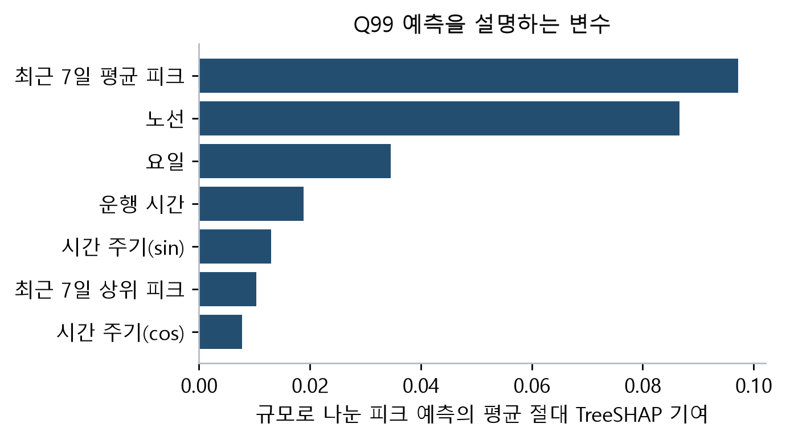
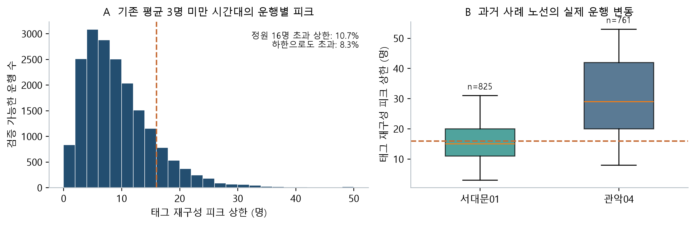
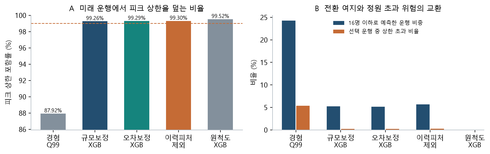
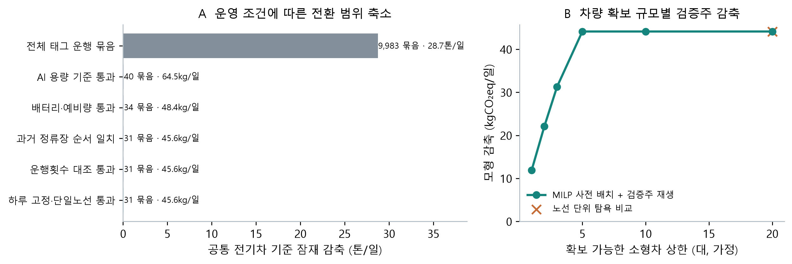

# 서울 마을버스의 서비스 유지형 탈탄소화

AI 피크 수요 예측과 제약 기반 차량 배치

전예준·김명관 | 작다고 감편하지 마라 | 분석·문헌 확인: 2026.10.14 · 운행 검증 보조 기록(제출본은 [분석보고서](작다고감편하지마라_분석보고서.pdf))

**평균 수요에 따른 소형화 후보를 운행별 수요와 운영 제약으로 검증하였다.** 기존 평균 3명 미만 시간대의 검증 가능 운행 중 8.3%는 태그 재구성 하한만으로도 16명을 초과했다. AI 상한 예측과 차량 배치를 연결해, 서비스를 유지하면서 전환할 조건과 제외할 이유를 제시한다.

## 1. 주제 및 2. 분석 배경·목적

마을버스의 짧은 이동은 언덕·골목의 주거지를 지하철과 생활시설에 연결한다. 이용량과 운송수입이 적더라도, 보행이 어렵거나 대체수단이 부족한 시민에게는 전체 이동을 성립시키는 구간일 수 있다. 따라서 탄소 감축은 이러한 연결을 유지하는 운행·차량 조건과 함께 평가해야 한다.

서울시는 2025년 12월 마을버스 서비스 개선 합의에서 2026년 재정지원 412억→500억원, 전체 운행 약 5% 확대를 발표했다[1]. 이는 서비스 확충 계획이며 확인된 실현 성과가 아니다. 필요한 운행을 유지·확대할 때 어느 크기의 친환경 차량을 배치해야 하는지에 대한 판단이 필요하다. 500억원을 본 분석의 차량 구매 예산으로 사용하거나 증편률을 7월 기록에 다시 더하지 않았다.

고령자의 교통카드 이용과 도시특성 연구[2], 교통약자 수요 기반 저상버스 배치 연구[3]는 이용과 접근 조건의 중요성을 보여준다. 본 연구는 이 문제를 **평균 기반 후보의 피크 위험 검증→AI 상한 예측→차량·충전 제약에 따른 선별**로 연결한다. 참여 목적은 더 큰 감축치를 제시하는 데 그치지 않고, 지원·차량 구매·시범운행의 판단 근거를 구체화하는 것이다.

## 3. 활용 데이터

| 활용 데이터·선정 이유 | 제공기관 / 플랫폼 | 출처 URL |
| --- | --- | --- |
| 교통카드 이용·노선·정류장: 운행별 피크, 경로코드 승차 | 서울시 / T-DATA | [t-data.seoul.go.kr / 20006](https://t-data.seoul.go.kr/dataprovide/trafficdataviewfile.do?data_id=20006) |
| 정류장별 운행횟수: 카드 운행 키의 독립 대조 | 서울시·TOPIS / 열린데이터광장 | [data.seoul.go.kr / OA-21220](https://data.seoul.go.kr/dataList/OA-21220/S/1/datasetView.do) |
| 도로망·5분 속도: 주행 저항과 운행 환경 | 국토교통부 / ITS | [its.go.kr / nodelink](https://www.its.go.kr/nodelink/nodelinkStatus?service=inquiryNodelink); [its.go.kr / opendata](https://www.its.go.kr/opendata/) |
| 노선 경로·정류장: 도로 매칭·노선 거리 | 서울시 / 버스 API·열린데이터광장 | [ws.bus.go.kr / getRoutePath](http://ws.bus.go.kr/api/rest/busRouteInfo/getRoutePath); [OA-1095](https://data.seoul.go.kr/dataList/OA-1095/L/1/datasetView.do) |
| 시간대 승하차: 기존 평균 기준의 후보 재평가 | 서울시 / 열린데이터광장 | [data.seoul.go.kr / OA-12913](https://data.seoul.go.kr/dataList/OA-12913/F/1/datasetView.do) |
| DEM·생활인구: 경사 및 노선 주변 인구 속성 | 국토지리정보원·서울시 / 국토정보·열린데이터 | [map.ngii.go.kr](https://map.ngii.go.kr/); [서울 생활인구](https://data.seoul.go.kr/dataVisual/seoul/seoulLivingPopulation.do) |
| 전기차 제원·배출계수: 정원·배터리·탄소 환산 | 현대·Karsan·기후부 / 공식 홈페이지 | 제조사 제원 [6,7], 전력계수 [8] |

교통카드: 7/6~8/9, 35일·247개 노선·846,653개 운행 키. 기존 도로 속도·인구는 7월, API 경로·정류장 일부는 9월 자료이다. 시점·거리 차이를 진단해 정책 후보를 제한했다. 속도 AI의 추가 입력 상세 출처는 코드 문서에 제공한다.

<!-- page break -->

## 4. 분석 과정 및 방법

### 4.1 운행별 수요 재구성과 자료 대조

차량·노선·출발시각을 운행 키로 묶고, 인접 자료일의 동일 키를 합쳤다. 승차·하차 사건을 시각순으로 누적해 운행별 최대 재차를 재구성했다. 같은 분에 발생한 승하차는 순변화 기반 하한과 승차 우선 상한을 계산하고, 하차 미완결 승객을 상한에 더했다. 이는 태그 기반 구간이며 미태그 승객까지 포함한 실측 정원은 아니다.

출발 이전 승차, 미완결 5% 초과, 비정상 관측시간·자정 이후 미종료 운행을 모델 검증에서 제외했다. 전체 키 중 75.7%를 검증 가능 표본으로 사용했다. 이전 날짜의 결과는 다음 날짜 시작 전에 확보된 값만 쓴다. TOPIS 정류장 통과횟수 대비 카드 운행 키의 중앙 비율은 0.991였다. 재방문·순환 구간의 거리 불확실성은 별도 관리했다.

### 4.2 차종·에너지·정수계획

소형차는 e-JEST M2 휠체어 배치의 운전자 제외 16명·105kWh를 참조한다[7]. 국내 인증과 노선 적합성은 미확인이다. 공통 7t 전기차와 5t 소형차의 동일 노선 주행 저항·냉방·정지출발·체류·충전손실을 계산해 차량 크기 효과만 비교했다. 카운티의 303/338km를 서로 다른 시험주기로 오해한 보정을 수정하고, 정속 자료로 Cd만 식별했다[6].

MILP는 노선별 소형차 수(정수)와 차량·날짜 운행 묶음의 전환(이진)을 선택해 모형 탄소 감축을 최대화한다. 같은 날 한 차량의 전체 운행을 교체하며 기록된 출발 패턴과 경로를 유지한다. 예측 상한≤16명, 배터리·예비량, 차량 수, 과거 운행횟수 조건을 적용한다. 보정 7일의 정류장 순서가 일치할 때 경로를 재사용하고 에너지 거리는 두 출처 중 큰 값을 쓴다. 보정 주간으로 차량을 사전 배분한 뒤 검증 주간에 순차 재생하였다.

## 5. AI 기술 활용

기존 XGBoost 도로 속도 산출물을 에너지 입력으로 재사용하고, 새로 XGBoost 분위수 회귀 Q50·Q95·Q99를 구현했다[9]. 노선·시간·요일·공휴일·경로 특성과 이전 7일 수요를 입력한다. 노선별 규모 차이는 과거 피크 평균+2명으로 목표를 정규화해 반영하고, 보정 주간의 정규화 잔차 상위 순서통계량으로 Q99를 보완했다[4]. TreeSHAP은 예측의 변수 기여를 설명하며 인과효과로 해석하지 않는다.

| 학습 | 오차 보정·차량 배분 | 개발 비교 | 독립 최종 검증 |
| --- | --- | --- | --- |
| 7/6~7/19 | 7/20~7/26 | 7/27~8/2 | 8/3~8/9 |

원척도 모델을 개선하는 과정에서 확인한 개발 주간은 독립 검증에서 제외했다. 같은 날·미래의 수요는 피처에 넣지 않는다. 최종 검증은 앞선 날짜의 결과만 다음 날짜에 업데이트하는 방식이며, 시간 의존성 때문에 보정 상한의 보편적 99% 보장은 주장하지 않는다.

그림 1. 독립 검증 표본의 Q99 TreeSHAP. 정규화 목표의 예측 기여이며 최종 인원은 과거 수요 규모를 곱해 얻는다.

**생성형 AI(Codex)**는 수집·모델·제약 코드 작성과 단위·누수·해석 검토에 사용했다. 검토 기준을 정리한 재현 프롬프트: ① “이전 날짜만으로 수요 피처를 만들고, 개발·보정·최종 검증의 역할을 분리하라.” ② “차량 정원에서 운전자를 제외하고, 태그 누락·배터리·자료 차이를 반영하되 실측 배출이나 실제 구매비로 단정하지 마라.”

<!-- page break -->

## 6. 분석 내용 및 결과

### 6.1 평균 기준의 소형화 후보는 피크 검증이 필요하다

기존 평균 3명 미만 시간대에 해당하는 최종 검증 가능 운행은 18,951개였다. 이 중 16명 초과 비중은 재구성 하한 8.3%, 상한 10.7%였다. 이는 태그·시각 처리에 따른 범위이며 통계적 신뢰구간이 아니다.

그림 2. 기존 평균 기준으로 선별한 시간대에도 피크 수요가 존재한다. 우측 상자는 중앙값·사분위, 수염은 5~95% 범위이며 일평균 구간 최대와 다른 지표이다.

기존 고의존 소형화 후보 29개 중 25개는 검증주 피크 상한 Q99가 16명을 넘었다. 전체 평균 최대≤8명 집합도 72개 중 63개가 초과했다. 서대문01·관악04의 Q95는 31.0명·53.0명으로, 기존 후보를 곧바로 하루 전체 소형차로 바꿀 근거는 부족하다.

### 6.2 AI의 가치는 예측 정확도와 전환 위험을 함께 줄이는 데 있다

| 방법 | 상한 포함률 | 16명 이하 예측 비중 | 선택 운행의 상한 초과율 |
| --- | --- | --- | --- |
| 과거 경험 Q99 | 87.92% | 24.24% | 5.34% |
| 규모보정 XGB Q99 | 99.26% | 5.22% | 0.22% |
| 오차보정 XGB Q99 | 99.29% | 5.11% | 0.21% |
| 트리 이력피처 제외 | 99.30% | 5.67% | 0.25% |
| 원척도 XGB Q99 | 99.52% | 0.00% | 선택 없음 |

그림 3. 최종 검증 128,202개 운행에서의 방법 비교. ‘상한 초과’는 실제 잠재 피크의 정확한 초과율이 아니라 검증 가능한 태그 상한 기준이다.

보정 모델의 포함률은 99.29%, 선택 운행 초과율은 0.21%였다. 경험 Q99의 87.92%·5.34%와 비교해 안전 여지와 전환 범위의 교환을 확인했다. 원척도 모델처럼 아무 운행도 선택하지 않는 높은 포함률은 정책 성능이 충분하다는 뜻이 아니다.

<!-- page break -->

### 6.3 수요·충전·자료 조건을 적용하면 전환 범위가 달라진다

그림 4는 모든 차량을 작은 차로 바꾸는 잠재치에서 용량·배터리·거리·자료 대조 조건을 순서대로 적용한 결과이다. 단계의 감축량은 공통 전기차 기준 크기 효과이며 기존 현재 차량 구성 대비 7.53톤/일과 분모·차종·모형이 다르다. 조건별 감소를 실패로 감추지 않고 필요한 추가 조사와 도입 제약으로 해석한다.

그림 4. A: 운행 묶음별 제약 선별. B: 사전 배분 차량의 검증주 재생. 배출은 운행 전력사용의 CO₂eq이며 차량 제조는 제외한다. 차량 수는 실제 예산·보유대수가 아닌 가정이다.

| 확보 상한 | 배분 차량 / 노선 | 검증주 모형 감축 | 전력비 절감(가정) |
| --- | --- | --- | --- |
| 1대 | 1대 / 1개 | 11.9kg/일 | 5,716원/일 |
| 2대 | 2대 / 2개 | 22.1kg/일 | 10,585원/일 |
| 3대 | 3대 / 2개 | 31.3kg/일 | 14,983원/일 |
| 5대 | 5대 / 3개 | 44.1kg/일 | 21,149원/일 |

20대 상한에서도 5대·3개 노선만 배분되어 44.1kg/일의 크기 효과를 얻었다. 검증주 644개 기록 운행을 전환한 시나리오다. 이 조건에서는 추가 구매보다 용량·운영 적합성이 더 큰 제약이었다. 동일 특수 구조의 한계편익 탐욕법은 보정 기간 최적값과 일치해, MILP만의 우월성을 주장하지 않는다.

| 사례 노선 | 검증 지표 | 판단의 변화 |
| --- | --- | --- |
| 서대문01 | 31.0명 | 평균 기반 소형화 후보를 재검토 |
| 관악04 | 53.0명 | 피크 수요에 맞는 수송 용량 유지 |
| 중랑01 | 2대 배분 | 하루 고정 소형차 시범 조건 확인 |
| 서초05 | 2대 배분 | 하루 고정 소형차 시범 조건 확인 |
| 서초01 | 1대 배분 | 하루 고정 소형차 시범 조건 확인 |

20대 조건의 전환 운행 중 15.7%는 태그 품질 기준상 정원 검증이 불가능했다. 검증 가능 543개 중 상한 초과는 2개였다. ‘상한 예측을 적용했다’는 이유만으로 승차 거부가 없다고 단정할 수 없으며, 실제 피크·휠체어 이용과 공차 운행을 확인해야 한다.

### 6.4 비용은 확인된 범위와 가격 미확인 영역을 구분한다

전력비 200원/kWh를 가정한 절감은 하루 21,149원이다. 365일 단순 환산 시 차량당 연 1,543,846원의 순추가비용까지 상쇄한다. 구매·보조금·인건비·정비비를 포함한 TCO는 아니므로, 실제 견적으로 추가 구매와 교체 시점 전환을 비교해야 한다.

같은 16명 정원에서 속도·냉방·회생·배터리·차고지 가정을 바꾼 감축은 37.8~57.0kg/일이었다. 이는 조건별 민감도 범위이며 신뢰구간이 아니다. 시간 블록 교대나 낮 충전은 실제 차고지·근무표 확보 후 별도 검증해야 한다.

<!-- page break -->

## 7. 정책 제안 및 기대효과

서울시·자치구는 운행 정상화와 친환경 차량 지원을 연계하되, 평균 재차만으로 소형차 구매를 결정하지 않아야 한다. 운수사는 AI를 수송 용량의 대체 근거가 아니라 전환 위험을 사전에 식별하는 도구로 사용할 수 있다. 노선·정류장·기록된 출발 패턴을 유지한 조건에서 다음과 같이 적용한다.

| 정책 단계 | 적용 대상·실행 내용 | 확인할 성과 |
| --- | --- | --- |
| 후보 재검증 | 평균 기준 후보를 운행별 피크·태그 품질·차량 정원으로 다시 선별 | 정원 초과·누락 운행·피크 대체차 필요 |
| 교체 시점의 저상 소형차 시범 | 배터리·자료 조건을 통과한 후보의 국내 인증·도로 폭·회차·충전·휠체어 탑승 확인 | 실차 kWh/km·전력비·대기·승차 거부·접근성 |
| 필요 노선의 용량·지원 유지 | 서대문01·관악04 등 피크가 큰 사례는 수송 용량을 유지하고 적합한 전기화 검토 | 운행 이행률·교통약자 탑승·서비스 연속성 |
| 구매·지원 의사결정 | 실제 견적·차량 수명·정비·보조금을 받아 총비용과 감축량 재산정 | 총비용·감축비용·증분 예산·고령자 이용 변화 |

기대효과는 감축량 자체와 함께 오판을 줄이는 데 있다. 피크 수요 때문에 유지할 용량, 자료 부족으로 보류할 후보, 충전·경제성 조건을 확인할 후보를 구분하면 재정지원과 차량 구매의 근거가 구체화된다. 경로·배차를 유지하는 설계는 주변 고령 생활인구의 접근 기회를 보호하는 방향이지만, 실제 고령 이용자의 편익 증가를 측정한 결과는 아니다.

### 한계와 후속 검증

분석은 여름 5주에 한정되며 검증 가능 태그 운행의 선택 편향이 있다. 경로코드는 모든 고령 이용자를 포괄하지 않고 장애코드는 휠체어 여부와 다르다. 카드 키와 TOPIS 통과횟수의 정의 차이, 미태그·무승객 운행, 7월/9월 공간자료 차이가 남고 평일 속도를 주말·야간에 근사 적용했다. 실제 차종·차고지·충전기·근무표·실차 전력 확보 전에는 배치를 실행 확정안이나 감축 실적으로 사용할 수 없다. 노선 폐지 접근성·목적지 편익은 새 검증에서 재산정하지 않았다.

## 8. 분석 도구 및 참고문헌

Python 3.13, pandas·NumPy·PyArrow, XGBoost 3.4, SciPy MILP(HiGHS), Matplotlib, ReportLab. 그림 1~4는 실제 산출물로 생성했다(필수 분석결과 이미지 포함). 공개 자료의 SHA-256·내부 날짜·코드·설정 해시, 테스트와 재현 절차를 함께 보존하였다.

[1] 서울시 (2025.12.21). 마을버스 서비스 개선 합의. [원문](https://www.seoul.go.kr/news/news_report.do?nttNo=448993)

[2] 김성아 외 (2023). 서울시 고령자의 대중교통 이용에 영향을 미치는 도시특성 분석. 국토지리학회지 57(4), 377-390. [원문](https://doi.org/10.22905/kaopqj.2023.57.4.2)

[3] 김명환·이재현 (2026). 교통약자 수요 기반 저상버스 배치 전략을 통한 이용 형평성 개선효과 분석. 대한지리학회지 61(3), 351-370. [원문](https://doi.org/10.22776/kgs.2026.61.3.351)

[4] Romano et al. (2019). Conformalized Quantile Regression. [원문](https://arxiv.org/abs/1905.03222)

[5] Nakao et al. (2026). Joint optimization of charging infrastructure and fleet mix for CO₂-constrained feeder services. Applied Energy 405, 127216. [원문](https://doi.org/10.1016/j.apenergy.2025.127216)

[6] 현대자동차. 카운티 일렉트릭 제조사 제원·정속 주행거리. [원문](https://www.hyundai.com/kr/ko/c/products/bus/county-electric)

[7] Karsan. e-JEST 제원·휠체어 배치별 정원. [원문](https://www.karsan.com/en/electric-bus/e-jest/e-jest-specs)

[8] 기후에너지환경부 (2025.12.18). 2023년 전력배출계수 0.4173tCO₂eq/MWh 공표. [원문](https://niwdc.mcee.go.kr/home/web/board/read.do?boardId=1829260&boardMasterId=939&menuId=10598)

[9] XGBoost. Quantile regression 공식 예제. [원문](https://xgboost.readthedocs.io/en/stable/python/examples/quantile_regression.html)

[10] SciPy. milp 공식 문서. [원문](https://docs.scipy.org/doc/scipy/reference/generated/scipy.optimize.milp.html)

[11] 인사혁신처 (2026.4.29). 제헌절 공휴일 재지정. [원문](https://www.mpm.go.kr/mpm/comm/newsPress/newsPressRelease/?boardId=bbs_0000000000000029&cntId=4250&mode=view)

분석 코드 및 상세 데이터 출처: [https://github.com/ejjunm/seoul-maeul-bus-carbon](https://github.com/ejjunm/seoul-maeul-bus-carbon)

신규 구현·입력 계약·추가 진단: docs/MAEUL_UPGRADE_IMPLEMENTATION.md 및 docs/report/maeul_bus_upgrade_validation.md. 제출 전 저장소에 신규 모듈과 재현 입력 안내를 반영해야 한다.